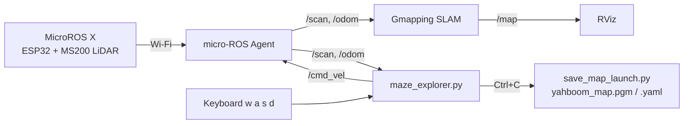
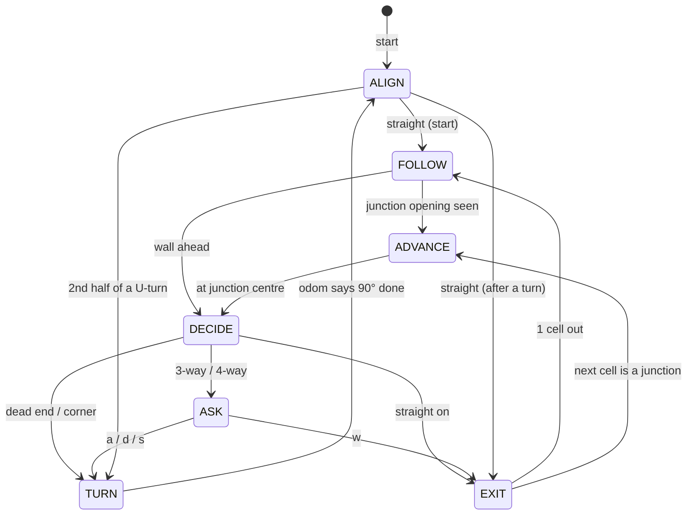

# MicroROS X Maze Explorer

Autonomous maze mapping for the **Yahboom MicroROS X** robot with **ROS 2** and **LiDAR**.

The robot explores an unknown 10 × 10 maze with the **right-wall-follower** rule while **Gmapping** builds the map. At every 3-way or 4-way junction it stops and asks you which way to go, then saves the map automatically when you press `Ctrl+C` at the goal.

The LiDAR keeps the robot driving straight and parallel to the walls, stops it at the centre of each junction, and steers it away from walls, so the map stays clean even when the wheels slip.

> **Status:** tested in a simulation of our 10 × 10 maze (30 cm and 40 cm corridors, with wheel slip, odometry error and Wi-Fi delay). On the real robot, v4 was tested; v5 (junction centring) still needs a full real-robot run.

---

## Contents

- [Files in this repository](#files-in-this-repository)
- [Quick start](#quick-start)
- [How it works](#how-it-works)
- [Parameters you may need to change](#parameters-you-may-need-to-change)
- [Troubleshooting](#troubleshooting)
- [Suggested learning path for new members](#suggested-learning-path-for-new-members)
- [Development history](#development-history)
- [References](#references)

---

## Files in this repository

| File | What it is | When to use it |
| --- | --- | --- |
| `maze_explorer.py` | **The full program.** Right wall follower + asks you at junctions + LiDAR heading control + wall avoidance + saves the map on `Ctrl+C`. Every line has a Thai comment. | The main program for mapping the maze |
| `right_wall_follower.py` | The same driving code **without** the junction questions and map saving. The robot always follows the right-hand rule by itself. | Fully autonomous runs, or to study the driving logic alone |
| `junction_asker.py` | Only the "stop and ask the user" part: vote on open directions, classify the junction, ask w/a/s/d. Includes a demo node that **does not move the robot**. | To study or reuse the junction logic |
| `lidar_wall_avoidance.py` | Only the LiDAR wall-avoidance layer, as a small class plus a demo node that drives forward and steers away from walls. | To study or reuse wall avoidance |

The three smaller files are cut out of `maze_explorer.py` and use the same logic and default values, so you can learn one part at a time.

---


**Maze**

- 10 × 10 cells, thin wall panels, corridors **30 cm or 40 cm** wide (measured automatically)
- Walls at right angles; flat floor
  

**Topics used**

| Topic | Type | Direction |
| --- | --- | --- |
| `/scan` | `sensor_msgs/LaserScan` | input |
| `/odom` | `nav_msgs/Odometry` | input |
| `/cmd_vel` | `geometry_msgs/Twist` | output |
| `/beep` | `std_msgs/UInt16` | output (optional, off by default) |

---

## Quick start

Open **5 terminals**. Terminals 1–4 are the same steps as the Yahboom LiDAR course (P7-2 to P7-5); terminal 5 replaces keyboard driving (P7-6) and manual map saving (P7-7).

```bash
# T1 - connect the robot to the computer (micro-ROS Agent over Wi-Fi)
sh start_agent_computer.sh

# T2 - robot bringup (odometry, TF)
ros2 launch yahboomcar_bringup yahboomcar_bringup_launch.py

# T3 - RViz, to watch the map being built
ros2 launch yahboomcar_nav display_launch.py

# T4 - Gmapping SLAM
ros2 launch yahboomcar_nav map_gmapping_launch.py

# T5 - the maze explorer
python3 maze_explorer.py                                   # measures the corridor width itself
python3 maze_explorer.py --ros-args -p cell_size:=0.40     # or tell it: 40 cm corridors
```

**Before you start T5:** put the robot between two walls, roughly facing along the corridor. It may be tilted by up to about 20°; it straightens itself with the LiDAR before driving.

**At a junction** the terminal shows:

```
============================================================
  3-WAY JUNCTION (T-junction)   #4   - robot stopped
============================================================
                (wall)
                   =
  [a] LEFT --- ROBOT --- [d] RIGHT
                   |
               (came from)
  Choose: [a] LEFT / [d] RIGHT / [s] BACK
  (just Enter = RIGHT, right-hand rule)
>
```

Type `w` (forward), `a` (left), `d` (right) or `s` (back) and press Enter. Pressing Enter alone uses the right-hand rule.

**At the goal** press `Ctrl+C` once in T5 and wait. The robot stops, then the map is saved with `ros2 launch yahboomcar_nav save_map_launch.py` (`yahboom_map.pgm` / `.yaml`), plus a time-stamped backup map and a route log. **Keep T4 (Gmapping) running until the map is saved.**

**Other programs**

```bash
python3 right_wall_follower.py                  # fully autonomous, never asks (save the map by hand, P7-7)
python3 junction_asker.py                       # robot stays still: votes with the LiDAR and asks you
python3 lidar_wall_avoidance.py                 # drives slowly forward and steers away from walls
```

---

## How it works

### Data flow



Inside `maze_explorer.py`, a timer runs `loop()` **20 times per second**. Each loop:

1. Measures distances (front, left, right) and **the robot's angle to the walls** from the latest LiDAR scan.
2. Runs one step of the **state machine** below.
3. Computes a speed command, passes it through the **wall-avoidance layer**, and publishes it to `/cmd_vel`.

### State machine



| State | What the robot does |
| --- | --- |
| `ALIGN` | Rotates in place until the LiDAR says it is parallel to the walls (within 1.5°). Used at the start and after every turn. |
| `FOLLOW` | Drives along the middle of the corridor, parallel to the walls. |
| `ADVANCE` | Slows down into the exact centre of a junction. |
| `DECIDE` | Straightens up, waits 0.3 s, then looks left/front/right 10 times and votes on which ways are open. |
| `ASK` | 3-way or 4-way junction: waits for your key press. |
| `TURN` | Turns 90° in place using odometry. A U-turn is two 90° turns with `ALIGN` in between. |
| `EXIT` | Drives one cell out of the junction, ignoring side openings, so the same junction is not asked twice. |

**Right-hand rule** (used whenever the robot decides by itself, or when you just press Enter): right → forward → left → back.

### The four ideas that make the real robot accurate

**1. Measuring the angle to the walls with the LiDAR** (`lidar_heading_error`, `wall_score`)
Odometry drifts when the wheels slip, so the robot measures its angle from the walls instead. It rotates the LiDAR points by test angles from −30° to +30° and counts how many points fall into the same 1 cm "row". At the correct angle the points of every wall line up, so the score is highest. Using all walls at once makes this robust to corners and wall ends. Resolution: 0.1°.

**2. Driving straight and centred** (`wall_follow_w`)
`turn speed = centring push + 1.5 × wall angle`
The centring push (P controller, Kp = 2.5) is limited to 0.10 rad/s, smaller than the angle correction, so the robot drifts back to the centre while staying parallel instead of driving diagonally.

**3. Stopping at the junction centre** (`junction_remaining`, `side_clear`)
The robot looks along the line of the side wall, finds the gap (the junction opening) and computes its midpoint. It slows down as it gets close and subtracts the distance it travels during the Wi-Fi delay (`sensor_delay`). When voting, a side counts as open only if there is really no wall beside the robot, so it does not ask again after passing a junction.

**4. Wall avoidance** (`safe_cmd`, also in `lidar_wall_avoidance.py`)
A box as wide as the robot plus 2 cm on each side sits in front of it (20 cm × 16 cm for 30 cm corridors). If a LiDAR point falls inside, the robot slows to 0.03 m/s and turns away, harder the deeper the wall intrudes: `0.2 + 6 × depth` rad/s. Walls running parallel beside the robot are outside the box, so normal driving is not disturbed.

---

## Parameters you may need to change

Pass any of these with `--ros-args -p name:=value`.

| Parameter | Default | Change it when |
| --- | --- | --- |
| `cell_size` | `0.0` (measure) | You know the corridor width: `0.30` or `0.40` |
| `linear_speed` | `0.08` m/s | Faster or slower driving (slow makes a sharper map) |
| `sensor_delay` | `0.2` s | Robot still stops **past** the junction centre → `0.3`; stops **before** it → `0.1` |
| `lidar_offset_x` | `0.0` m | The LiDAR is not above the robot's turning centre (e.g. 3 cm in front → `0.03`) |
| `robot_half_width` | `0.08` m | Your robot is wider than 16 cm (use half its width) |
| `lidar_ccw` | `true` | Left and right are swapped (see Troubleshooting) |
| `lidar_front_deg` | `0.0` | The LiDAR is mounted rotated (try `180`) |
| `ask_min_ways` | `3` | `2` = also ask at corners, `5` = never ask |
| `use_safety` | `true` | Set `false` to test without the wall-avoidance layer |
| `beep_on_ask` | `false` | Beep when the robot asks (check `/beep` with the course's beep test first) |

---

## Troubleshooting

| Problem | What to check |
| --- | --- |
| Robot does not move | Is the micro-ROS Agent (T1) connected? Does `ros2 topic echo /scan` show data? |
| Robot turns the wrong way / left and right swapped | Rotate the robot to the left by hand and watch `ang=` in the status line: it should become **negative**. If not, run with `-p lidar_ccw:=false`. |
| Robot drives crooked | Look at `pts=` in the status line. Fewer than about 10 means the LiDAR cannot see the walls clearly. |
| Stops a little past the junction and asks late | Increase `sensor_delay` to `0.3`; set `lidar_offset_x` if the LiDAR is not at the turning centre. |
| Map not saved after `Ctrl+C` | T4 (Gmapping) must still be running. Press `Ctrl+C` only once and wait. If `ros2` is "not found", source ROS 2 in T5. |
| Measured corridor width looks wrong | Pass it directly: `-p cell_size:=0.30`. |

The status line printed every second helps a lot:

```
[FOLLOW ] F=0.45 L=0.15 R=0.16 ang= +0.8 pts=31 junc=+12cm
```

`F/L/R` = free distance front/left/right (m), `ang` = angle to the walls (°), `pts` = points on the best wall line, `junc` = distance left to the junction centre.

---

## Suggested learning path for new members

1. **ROS 2 Python basics.** Write a node that publishes a `Twist` to `/cmd_vel` and makes the robot drive for 2 seconds. Subscribe to `/scan` and print the front distance.
2. **The LiDAR course (P7-2 to P7-7).** Map the maze by driving with the keyboard and save the map by hand. You will see why automation helps.
3. **`lidar_wall_avoidance.py`.** The smallest complete example: read `/scan`, make a decision, publish `/cmd_vel`.
4. **`junction_asker.py`.** Voting, classifying junctions, and reading the keyboard in a thread without blocking the robot.
5. **`right_wall_follower.py`.** The whole driving state machine without user interaction.
6. **`maze_explorer.py`.** Everything together. Read it with the Thai comments; lines marked ★ keep the robot parallel to the walls and lines marked ◆ find the junction centre.

---

## Development history

| Version | Problem found | Fix |
| --- | --- | --- |
| v1 | — | Right wall follower, ask at 3/4-way junctions (keys w a s d), auto-save the map on `Ctrl+C` |
| v2 | Relative turns added up errors; robot looped in one corner | Turns measured against the maze grid (multiples of 90°) |
| v3 | Hit walls when driving crooked | LiDAR wall-avoidance layer |
| v4 | Still drove crooked; turns and U-turns not straight | LiDAR wall-angle measurement, re-align after every turn, U-turn = 2 × 90°, 30/40 cm corridors |
| v5 | Stopped a little past junctions; asked again at the next wall | LiDAR junction-centre detection, Wi-Fi delay compensation, "side really clear" check |

---

## References

- [Yahboom MicroROS ESP32 Robot specifications](https://rcdrone.top/products/yahboom-microros-esp32-robot)
