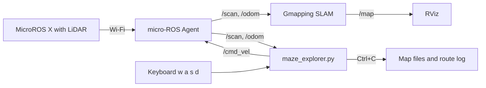
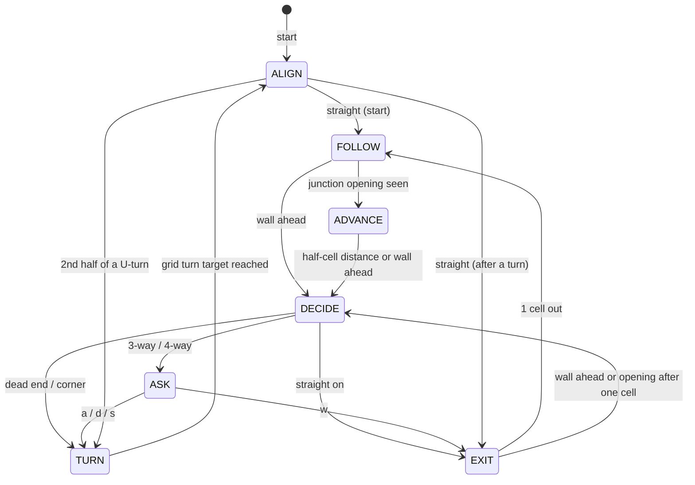

# MicroROS X Maze Explorer

Interactive maze exploration and mapping for the **Yahboom MicroROS X** robot with **ROS 2** and **LiDAR**.

The robot explores an unknown 10 × 10 maze with the **right-wall-follower** rule while **Gmapping** builds the map. At every 3-way or 4-way junction it stops and asks you which way to go, then saves the map automatically when you press `Ctrl+C` at the goal.

LiDAR feedback helps the robot drive parallel to the walls, stay near the middle of the corridor, and steer away from obstacles. After detecting a side opening, v4 advances half a cell using odometry to estimate the junction centre. Wheel slip and odometry error can still affect where it stops.

> **Version:** this README describes the supplied `maze_explorer.py` v4. The project notes report that v4 was tested on the real robot. The code was reviewed for this README; no new simulation or hardware test was performed.

---

## Contents

- [Files in this repository](#files-in-this-repository)
- [Quick start](#quick-start)
- [How it works](#how-it-works)
- [Parameters you may need to change](#parameters-you-may-need-to-change)
- [Troubleshooting](#troubleshooting)
- [Suggested learning path for new members](#suggested-learning-path-for-new-members)
- [Development history](#development-history)
- [References](#references)

---

## Files in this repository

| File | What it is | When to use it |
| --- | --- | --- |
| `maze_explorer.py` | **The full program.** Right wall follower + asks you at junctions + LiDAR heading control + wall avoidance + saves the map on `Ctrl+C`. Includes extensive Thai comments. | The main program for mapping the maze |
| `right_wall_follower.py` | A standalone right-wall-following program, described by the project as running without junction questions or map saving. The robot always follows the right-hand rule by itself. | Fully autonomous runs, or to study the driving logic alone |
| `junction_asker.py` | Only the "stop and ask the user" part: vote on open directions, classify the junction, ask w/a/s/d. Includes a demo node that **does not move the robot**. | To study or reuse the junction logic |
| `lidar_wall_avoidance.py` | Only the LiDAR wall-avoidance layer, as a small class plus a demo node that drives forward and steers away from walls. | To study or reuse wall avoidance |

The three smaller files are learning modules described in the project notes. Only `maze_explorer.py` was supplied for this review, so their current implementation and defaults have not been verified. Do not assume their values match the main program: the notes report `0.03 m/s` in the standalone wall-avoidance file, while the supplied main program uses `safe_speed = 0.05 m/s`.

---


**Maze**

- 10 × 10 cells, thin wall panels, corridors **30 cm or 40 cm** wide (measured automatically)
- Walls at right angles; flat floor
  

**Topics used**

| Topic | Type | Direction |
| --- | --- | --- |
| `/scan` | `sensor_msgs/LaserScan` | input |
| `/odom` | `nav_msgs/Odometry` | input |
| `/cmd_vel` | `geometry_msgs/Twist` | output |
| `/beep` | `std_msgs/UInt16` | output (optional, off by default) |

---

## Quick start

Open **5 terminals**. Terminals 1–4 are the same steps as the Yahboom LiDAR course (P7-2 to P7-5); terminal 5 replaces keyboard driving (P7-6) and manual map saving (P7-7).

```bash
# T1 - connect the robot to the computer (micro-ROS Agent over Wi-Fi)
sh start_agent_computer.sh

# T2 - robot bringup (odometry, TF)
ros2 launch yahboomcar_bringup yahboomcar_bringup_launch.py

# T3 - RViz, to watch the map being built
ros2 launch yahboomcar_nav display_launch.py

# T4 - Gmapping SLAM
ros2 launch yahboomcar_nav map_gmapping_launch.py

# T5 - the maze explorer
python3 maze_explorer.py                                   # measures the corridor width itself
python3 maze_explorer.py --ros-args -p cell_size:=0.40 -p turn_speed:=0.5     # or tell it: 40 cm corridors
```

**Before you start T5:** put the robot between two walls, roughly facing along the corridor. The program first estimates the corridor width, then attempts to align with the walls using LiDAR. Alignment ends when the error is below 1.5°, when wall-angle data is unavailable, or after the 3-second timeout.

**At a junction** the terminal shows:

```
============================================================
  3-WAY JUNCTION (T-junction)   #4   - robot stopped
============================================================
                (wall)
                   =
  [a] LEFT --- ROBOT --- [d] RIGHT
                   |
               (came from)
  Choose: [a] LEFT / [d] RIGHT / [s] BACK
  (just Enter = RIGHT, right-hand rule)
>
```

Type `w` (forward), `a` (left), `d` (right) or `s` (back) and press Enter. Pressing Enter alone uses the right-hand rule.

**At the goal** press `Ctrl+C` once in T5 and wait. The robot sends stop commands, then attempts to save the map with `ros2 launch yahboomcar_nav save_map_launch.py` (`yahboom_map.pgm` / `.yaml`), With the default `save_method:=both`, it also runs `nav2_map_server map_saver_cli` for a time-stamped map and writes a route log. Check the terminal output to confirm each map-saving command succeeded. **Keep T4 (Gmapping) running until the map is saved.**

**Other programs**

```bash
python3 right_wall_follower.py                  # fully autonomous, never asks (save the map by hand, P7-7)
python3 junction_asker.py                       # robot stays still: votes with the LiDAR and asks you
python3 lidar_wall_avoidance.py                 # drives slowly forward and steers away from walls
```

---

## How it works

### Data flow



Inside `maze_explorer.py`, a timer runs `loop()` **20 times per second**. Each loop:

1. Measures distances (front, left, right) and **the robot's angle to the walls** from the latest LiDAR scan.
2. Runs one step of the **state machine** below.
3. Publishes a speed command to `/cmd_vel`. Forward motion in `FOLLOW`, `ADVANCE`, and `EXIT` passes through the **wall-avoidance layer**; in-place turning and alignment publish their rotation commands directly.

### State machine



| State | What the robot does |
| --- | --- |
| `ALIGN` | Attempts to align within 1.5° using LiDAR. Continues if the angle is unavailable or the 3 s timeout is exceeded. Used at startup and after each turn step. |
| `FOLLOW` | Drives along the middle of the corridor, parallel to the walls. |
| `ADVANCE` | Drives another `cell_size / 2` from the detected opening, measured by displacement from the segment start in odometry. Stops earlier if the front wall is close. Uses heading control and wall avoidance; there is no distance-based deceleration to the junction centre. |
| `DECIDE` | Straightens up, waits 0.3 s, then checks left/front/right over 10 control ticks and uses a strict majority vote. These ticks may reuse the latest scan. |
| `ASK` | 3-way or 4-way junction: waits for your key press. |
| `TURN` | Rotates toward a target 90° from the nearest estimated maze-grid heading, using odometry and a 3° target tolerance. A U-turn uses two right-turn steps with `ALIGN` between them. |
| `EXIT` | Drives one cell before considering side openings again. A front wall causes an earlier `DECIDE`; after one cell, an open side leads directly to `DECIDE`, otherwise it returns to `FOLLOW`. |

**Right-hand rule** (used whenever the robot decides by itself, or when you just press Enter): right → forward → left → back.

### Four control mechanisms in v4

**1. Measuring the angle to the walls with the LiDAR** (`lidar_heading_error`, `wall_score`)
Odometry drifts when the wheels slip, so the robot measures its angle from the walls instead. It rotates the LiDAR points by test angles from −30° to +30° and counts how many points fall into the same 1 cm "row". At the correct angle the points of every wall line up, so the score is highest. Using all walls at once makes this robust to corners and wall ends. The search uses 1° coarse steps and 0.1° refinement steps; these are search increments, not a guarantee of physical accuracy.

**2. Driving straight and centred** (`wall_follow_w`)
`turn speed = centring push + 1.5 × wall angle`
The centring push (P controller, Kp = 2.5) is limited to 0.10 rad/s, smaller than the angle correction, so the robot drifts back to the centre while staying parallel instead of driving diagonally.

**3. Estimating the junction position with odometry** (`ADVANCE`, `traveled`)
A side is considered open when its measured distance exceeds `cell_size`. After three consecutive open control ticks, the robot records its position and enters `ADVANCE`. It drives another half cell (15 cm for a 30 cm corridor, or 20 cm for a 40 cm corridor), or stops earlier if the front distance is below `cell_size / 2 + front_gap`. This estimates the centre; v4 does not locate the opening midpoint from LiDAR geometry or compensate for sensor delay. `DECIDE` then attempts alignment, waits, and votes on open directions. The way count includes the route behind the robot.

**4. Wall avoidance** (`safe_cmd`, also in `lidar_wall_avoidance.py`)
A box as wide as the robot plus 2 cm on each side sits in front of it (20 cm × 16 cm for 30 cm corridors). If a LiDAR point falls inside, the robot caps forward speed at 0.05 m/s and turns away, harder the deeper the wall intrudes: `0.2 + 6 × depth` rad/s. The turn command is capped by `turn_speed`. If a detected point is closer than `robot_front + 0.01` (11 cm by default) in the forward direction, forward speed becomes zero while the robot turns away. Walls outside the box do not trigger this layer.

---

## Parameters you may need to change

Pass any of these with `--ros-args -p name:=value`.

| Parameter | Default | Change it when |
| --- | --- | --- |
| `cell_size` | `0.0` (measure) | You know the corridor width: `0.30` or `0.40` |
| `linear_speed` | `0.15` m/s | Adjust the requested forward speed |
| `turn_speed` | `0.8` rad/s | Adjust the turn-speed limit; the quick-start example uses `0.5` |
| `safe_speed` | `0.05` m/s | Adjust the forward-speed cap during wall avoidance |
| `front_gap` | `0.02` m | Adjust the front-stop threshold: half a cell plus this gap |
| `robot_half_width` | `0.08` m | Your robot is wider than 16 cm (use half its width) |
| `lidar_ccw` | `true` | Left and right are swapped (see Troubleshooting) |
| `lidar_front_deg` | `0.0` | The LiDAR is mounted rotated (try `180`) |
| `ask_min_ways` | `3` | `2` = also ask at corners, `5` = never ask |
| `use_safety` | `true` | Set `false` to test without the wall-avoidance layer |
| `save_method` | `both` | `launch`, `cli`, or `both` map-saving methods |
| `map_dir` | `~/yahboomcar_ws/src/yahboomcar_nav/maps` | Directory for the time-stamped CLI map and route log; falls back to `~/maze_maps` if its parent does not exist |
| `beep_on_ask` | `false` | Beep when the robot asks (check `/beep` with the course's beep test first) |

---

## Troubleshooting

| Problem | What to check |
| --- | --- |
| Robot does not move | Is the micro-ROS Agent (T1) connected? Does `ros2 topic echo /scan` show data? |
| Robot turns the wrong way / left and right swapped | Rotate the robot to the left by hand and watch `ang=` in the status line: it should become **negative**. If not, run with `-p lidar_ccw:=false`. |
| Robot drives crooked | Look at `pts=` in the status line. Fewer than about 10 means the LiDAR cannot see the walls clearly. |
| Stops away from the junction centre | Check `cell_size`, wheel slip, and odometry. v4 advances a fixed half cell after detecting the opening; it has no sensor-delay or LiDAR-offset compensation parameter. |
| Map not saved after `Ctrl+C` | T4 (Gmapping) must still be running. Press `Ctrl+C` only once and wait. If `ros2` is "not found", source ROS 2 in T5. |
| Measured corridor width looks wrong | Pass it directly: `--ros-args -p cell_size:=0.30`. |

The status line printed every second helps a lot:

```
[FOLLOW ] F=0.45 L=0.15 R=0.16 ang= +0.8 pts=31
```

`F/L/R` = free distance front/left/right (m), `ang` = angle to the walls (°), `pts` = points on the best wall line. There is no junction-distance field in v4.

---

## Suggested learning path for new members

1. **ROS 2 Python basics.** Write a node that publishes a `Twist` to `/cmd_vel` and makes the robot drive for 2 seconds. Subscribe to `/scan` and print the front distance.
2. **The LiDAR course (P7-2 to P7-7).** Map the maze by driving with the keyboard and save the map by hand. You will see why automation helps.
3. **`lidar_wall_avoidance.py`.** The smallest complete example: read `/scan`, make a decision, publish `/cmd_vel`.
4. **`junction_asker.py`.** Voting, classifying junctions, and reading the keyboard in a thread without blocking the robot.
5. **`right_wall_follower.py`.** The whole driving state machine without user interaction.
6. **`maze_explorer.py`.** Everything together. Read it with the Thai comments; lines marked ★ explain LiDAR wall-angle control. Study `ADVANCE` and `traveled()` for the odometry-based half-cell advance.

---

## Development history

| Version | Problem found | Fix |
| --- | --- | --- |
| v1 | — | Right wall follower, ask at 3/4-way junctions (keys w a s d), auto-save the map on `Ctrl+C` |
| v2 | Relative turns added up errors; robot looped in one corner | Turns measured against the maze grid (multiples of 90°) |
| v3 | Hit walls when driving crooked | LiDAR wall-avoidance layer |
| v4 | Still drove crooked; turns and U-turns not straight | LiDAR wall-angle measurement, re-align after every turn, U-turn = 2 × 90°, tuned for the real robot |

---

## Implementation limits

- The right-hand rule is a local direction priority. This program does not maintain a visited-cell graph, plan a shortest path, or guarantee full maze coverage. Gmapping builds the map in a separate process.
- A manual direction that LiDAR reports as blocked produces a warning but is still executed.
- The control loop does not check scan freshness. When odometry has not updated for more than 0.5 s, it estimates motion from the last commanded velocities; this is not measured wheel motion.
- The robot does not detect the goal automatically. The operator ends the run with `Ctrl+C`. The shutdown handler also attempts map saving after a caught runtime exception.

## References

- [Yahboom MicroROS ESP32 Robot specifications](https://rcdrone.top/products/yahboom-microros-esp32-robot)
